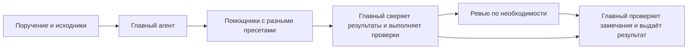
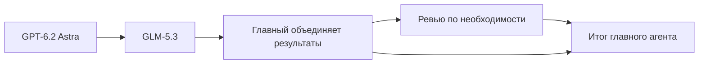
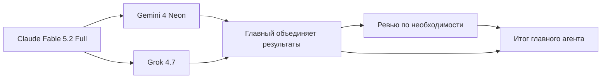
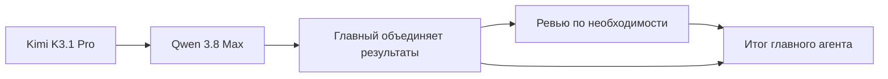
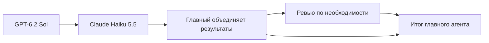
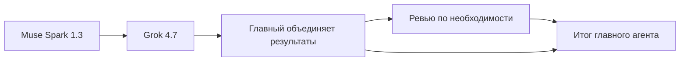
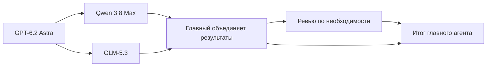
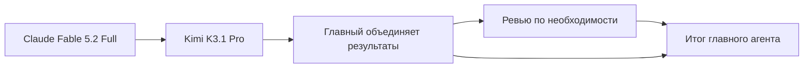

# Схемы работы агентов

Все девять связок описаны в [teams.json](../presets/teams.json). Сборка с --team all открывает в Astra и Workflow общий список из семи пресетов помощников, включая Ревью. Этот список наследуется пресетами семейства Workflow.

Схемы ниже описывают порядок поручения и передачи результатов. Файл связок хранит рекомендуемый главный пресет и дополнительные разрешённые пресеты детей. Автоматического запуска всей цепочки при выборе пункта меню нет. Главный агент вызывает помощников по запросу.

Все роли могут работать на одной модели. Вызывай subagent с нужным agent_preset, опуская provider, model и reasoning_effort для наследования маршрута. Для отдельного пресета используется spawn. subagent_fork наследует контекст и пресет родителя.

## Все настроенные связи

| Связка | Рекомендуемый главный пресет | Дополнительные пресеты помощников |
| --- | --- | --- |
| `debug` | GPT-6.2 Astra | GLM-5.3 |
| `delivery` | Claude Fable 5.2 Full | Gemini 4 Neon, Grok 4.7 |
| `analysis` | Kimi K3.1 Pro | Qwen 3.8 Max |
| `quick` | GPT-6.2 Sol | Claude Haiku 5.5 |
| `migration` | Muse Spark 1.3 | Grok 4.7 |
| `loyalty` | Kimi K3.1 Pro | Qwen 3.8 Max |
| `strategy` | Claude Fable 5.2 Full | Gemini 4 Neon, GLM-5.3 |
| `experiments` | GPT-6.2 Astra | Qwen 3.8 Max, GLM-5.3 |
| `executive` | Claude Fable 5.2 Full | Kimi K3.1 Pro |

Ревью доступен каждой связке. В сборке без --team явный выбор другого пресета ограничен Ревью. При отсутствии agent_preset ребёнок наследует пресет родителя.

## Общий порядок

Главный передаёт каждому помощнику полный текст поручения, входные данные или существующие пути, рабочую папку, границы чтения и записи, ожидаемый результат и критерии приёмки. Помощники возвращают результат главному. Для уточнений главный использует того же ребёнка через send_message. Передача данных между помощниками в схемах проходит через главного.

## debug — Исправление ошибки

Главный пресет **GPT-6.2 Astra**, ID `ptc-workflow-openai-astra-6-2`.

- **GLM-5.3**, `ptc-workflow-glm-5-3`. GLM проверяет симптом, формулирует гипотезу и способ воспроизведения.

Главный проверяет гипотезу, правит код и запускает тесты. Ревью проверяет итоговый diff.

Для запуска укажи цель и исходники, затем попроси главного вызвать перечисленные ID через subagent. Передай каждому назначенную роль. Провайдера и модель у детей наследуй. Главный дожидается ответов и проверяет их перед финальным результатом.

## delivery — Разработка функции

Главный пресет **Claude Fable 5.2 Full**, ID `ptc-workflow-fable-full`.

- **Gemini 4 Neon**, `ptc-workflow-gemini-4-neon`. Gemini ищет затронутые модули, зависимости и рабочие примеры.
- **Grok 4.7**, `ptc-workflow-grok-4-7`. Grok после реализации проходит пользовательский сценарий и соседние сценарии.

Главный проектирует изменение, реализует его и сводит проверки.

Для запуска укажи цель и исходники, затем попроси главного вызвать перечисленные ID через subagent. Передай каждому назначенную роль. Провайдера и модель у детей наследуй. Главный дожидается ответов и проверяет их перед финальным результатом.

## analysis — Анализ данных

Главный пресет **Kimi K3.1 Pro**, ID `ptc-workflow-kimi-k3-1-pro`.

- **Qwen 3.8 Max**, `ptc-workflow-qwen-3-8-max`. Qwen сверяет исходные данные, формулы, определения и итоговые величины.

Главный определяет методику, проверяет вычисления и готовит отчёт. Ревью сверяет выводы с доказательствами.

Для запуска укажи цель и исходники, затем попроси главного вызвать перечисленные ID через subagent. Передай каждому назначенную роль. Провайдера и модель у детей наследуй. Главный дожидается ответов и проверяет их перед финальным результатом.

## quick — Небольшая правка

Главный пресет **GPT-6.2 Sol**, ID `ptc-workflow-openai-sol-6-2`.

- **Claude Haiku 5.5**, `ptc-workflow-claude-haiku-5-5`. Haiku ищет места изменения и выбирает подходящие проверки.

Главный вносит правку и запускает проверки. Для простой задачи отдельный помощник необязателен.

Для запуска укажи цель и исходники, затем попроси главного вызвать перечисленные ID через subagent. Передай каждому назначенную роль. Провайдера и модель у детей наследуй. Главный дожидается ответов и проверяет их перед финальным результатом.

## migration — Перенос на другую машину

Главный пресет **Muse Spark 1.3**, ID `ptc-workflow-muse-spark-1-3`.

- **Grok 4.7**, `ptc-workflow-grok-4-7`. Grok проверяет инструкцию установки на чистом профиле и перечисляет недостающие шаги.

Главный собирает комплект, устраняет проблемы и повторяет установку. Проверка выполняется в отдельной папке.

Для запуска укажи цель и исходники, затем попроси главного вызвать перечисленные ID через subagent. Передай каждому назначенную роль. Провайдера и модель у детей наследуй. Главный дожидается ответов и проверяет их перед финальным результатом.

## loyalty — CRM и программа лояльности

Главный пресет **Kimi K3.1 Pro**, ID `ptc-workflow-kimi-k3-1-pro`.

- **Qwen 3.8 Max**, `ptc-workflow-qwen-3-8-max`. Qwen сверяет сегменты, заказы, начисления, списания, активность и расчёты эффекта.

Главный формирует бизнес-вывод с периодом, знаменателем и ограничениями. Для причинного эффекта проверяет контрольную группу и правила отбора.

Для запуска укажи цель и исходники, затем попроси главного вызвать перечисленные ID через subagent. Передай каждому назначенную роль. Провайдера и модель у детей наследуй. Главный дожидается ответов и проверяет их перед финальным результатом.

## strategy — Маркетинговая стратегия

Главный пресет **Claude Fable 5.2 Full**, ID `ptc-workflow-fable-full`.

- **Gemini 4 Neon**, `ptc-workflow-gemini-4-neon`. Gemini собирает подтверждённые факты о рынке, клиентах и конкурентах.
- **GLM-5.3**, `ptc-workflow-glm-5-3`. GLM проверяет допущения, экономику предложения и условия провала плана.

Главный сопоставляет факты и ограничения, выбирает приоритеты и формирует план. Проверку готовой стратегии запускает после её появления.

Для запуска укажи цель и исходники, затем попроси главного вызвать перечисленные ID через subagent. Передай каждому назначенную роль. Провайдера и модель у детей наследуй. Главный дожидается ответов и проверяет их перед финальным результатом.

## experiments — Акции и эксперименты

Главный пресет **GPT-6.2 Astra**, ID `ptc-workflow-openai-astra-6-2`.

- **Qwen 3.8 Max**, `ptc-workflow-qwen-3-8-max`. Qwen проверяет расчёты, сценарии и единицы измерения.
- **GLM-5.3**, `ptc-workflow-glm-5-3`. GLM проверяет сопоставимость групп, альтернативные объяснения, каннибализацию и причинный вывод.

Главный определяет критерий результата, сверяет противоречия и пересчитывает существенные величины. Итог содержит эффект и неопределённость.

Для запуска укажи цель и исходники, затем попроси главного вызвать перечисленные ID через subagent. Передай каждому назначенную роль. Провайдера и модель у детей наследуй. Главный дожидается ответов и проверяет их перед финальным результатом.

## executive — Материалы для руководства

Главный пресет **Claude Fable 5.2 Full**, ID `ptc-workflow-fable-full`.

- **Kimi K3.1 Pro**, `ptc-workflow-kimi-k3-1-pro`. Kimi сверяет тезисы и цифры с исходниками, проверяет периоды, знаменатели и уровень подтверждения.

Главный готовит управленческий вывод и структуру материала. Ревью получает финальную версию и источники. Для визуальной проверки нужен подходящий инструмент просмотра.

Для запуска укажи цель и исходники, затем попроси главного вызвать перечисленные ID через subagent. Передай каждому назначенную роль. Провайдера и модель у детей наследуй. Главный дожидается ответов и проверяет их перед финальным результатом.

## Анализ данных и лояльность

analysis и loyalty используют одинаковые связи между пресетами. Различаются тексты поручений и критерии приёмки. Для loyalty передавай определения CRM-метрик, периоды и правила отбора непосредственно в запросе.

## Ревью и доступ к файлам

Ревью читает файлы исходной рабочей папки и выполняет поиск. Запись и вызовы оболочки ограничены конфигурацией и проверкой инструментов. Другие пресеты используют инструменты Workflow по разрешениям DSH. Для них назначай конкретные папки и непересекающиеся области изменения. Сборку и исполняемые проверки после статического ревью запускает главный агент.

## Параллельность

Потолок зависит от фактической модели главного агента. Для DeepSeek в High допускаются два одновременно работающих потомка, в Max три. В лимит входят потомки всего дерева. В experiments Qwen и GLM могут работать параллельно. Ревью итогового результата запускается после получения и интеграции ответов.

## Что проверено

Маршрутизация первых трёх связок проверена в DSH с локальным тестовым провайдером. Сборка всех девяти связок прошла проверку конфигурации. В рабочем DSH выполнен реальный контроль Astra → Qwen + GLM на deepseek-official/deepseek-flash, Max у всех троих. Дети и главный завершили работу. Главный исправил численную ошибку одного помощника. [Входы и результат контрольного прогона](single-model.md#подтверждённый-контрольный-прогон).

Прогон подтвердил передачу результатов и сочетание инструкций на одной модели. Качество каждой схемы на больших задачах требует отдельного сравнения.
