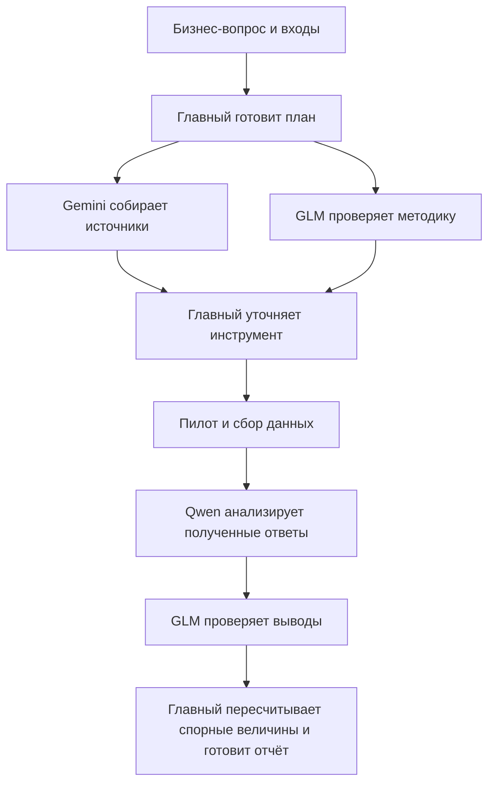

# Маркетинговые исследования в DSH на одной модели

Руководство для коллеги. Версия от 26 ноября 2026 года.

DSH PTC Presets содержит инструкции для нескольких рабочих ролей. В связке research главный агент ведёт исследование, помощники собирают факты, обрабатывают данные и проверяют методику. Все роли могут выполняться на одном DeepSeek. Названия Claude, Gemini, Qwen и GLM обозначают выбранные пресеты инструкций. Фактическая модель задаётся отдельно в DSH.

Репозиторий проекта — [Kotpes537/dsh-ptc-presets](https://github.com/Kotpes537/dsh-ptc-presets).

## Для каких задач подходит

Связка помогает подготовить исследование категории, проверить продуктовую концепцию, составить анкету, разобрать интервью и опрос, сопоставить результаты с внешними данными. Результат зависит от качества входов, доступности источников и возможности собрать реальные ответы.

Рабочий пример — сравнение двух вариантов упаковки или предложений. Исследовательский вопрос должен быть конкретным, например «какой вариант понятнее существующим покупателям категории и почему». Намерение купить, понимание предложения и фактическая покупка требуют собственных показателей.

Исторический тест по сигаретам в подготовку этой инструкции не входил. Пример ниже описывает новый шаблон исследования без утверждений о результатах прежнего теста.

## Участники и ответственность

| Агент | Пресет и ID | Работа и результат |
| --- | --- | --- |
| Главный | Claude Fable 5.2 Full | Формулирует вопрос, выбирает метод, организует этапы, сводит результаты, проверяет расчёты и готовит вывод для бизнеса |
| Исследователь источников | Gemini 4 Neon | Находит факты о категории, конкурентах, предложениях и ценах. Возвращает источники, даты, географию и ограничения |
| Аналитик | Qwen 3.8 Max | Проверяет таблицы ответов и расчёты, кодирует открытые ответы по согласованным правилам, выделяет сегменты |
| Методолог | GLM-5.3 | До сбора проверяет методику и анкету. После анализа проверяет, какие выводы поддерживают данные |
| Итоговый проверяющий | Ревью | По необходимости читает итоговые файлы и сопоставляет заявления с доказательствами |

Файл `presets/teams.json` хранит рекомендуемого главного и разрешённых помощников. Он открывает выбор пресетов в инструменте subagent. Вызовы и последовательность работы главный выполняет по поручению. Сам выбор research при сборке пакета не запускает исследование.

## Установка

Нужны установленный DSH, подключённая модель, Git, Python 3.10 или новее и PowerShell 7. Сначала запусти DSH, чтобы он создал профиль.

```powershell
git clone https://github.com/Kotpes537/dsh-ptc-presets.git
Set-Location dsh-ptc-presets
python scripts/presets.py build --team research
Expand-Archive dist/DSH-PTC-portable.zip -DestinationPath dist/portable -Force
```

Для всех связок используй `--team all`. Перед установкой дождись завершения прогонов и полностью выйди из DSH через меню приложения.

```powershell
.\dist\portable\Install-DSH-PTC.ps1 -WhatIf
.\dist\portable\Install-DSH-PTC.ps1
```

Для нестандартного расположения профиля добавь `-ProfileDir` с абсолютным путём. Установщик сверяет контрольные суммы и сохраняет резервную копию конфигурации. Если установленный блок отличается только списком допусков, список обновляется. При ином конфликте потребуется слияние по ID.

Запусти DSH, открой новую сессию и выбери Claude Fable 5.2 Full. Выбери свой DeepSeek и High или Max. Для Workflow-пресетов доступен навык `dsh-marketing-research`. В начале большого исследования попроси его прочитать.

## Как устроен цикл исследования



**Первый этап — постановка.** Укажи решение, которое предстоит принять, рынок и период, целевую аудиторию, материалы и ограничения. Главный формирует исследовательский вопрос и список проверяемых гипотез. Метод подбирается под вопрос и доступные входы.

**Второй этап — методика.** Зафиксируй критерии отбора участников, способ набора, метрики, форму анкеты или интервью, показ концепций и правила анализа. Главный передаёт GLM план до получения результатов. Для количественной оценки размер выборки обосновывается ожидаемым эффектом, неопределённостью и способом отбора. Для качественных интервью важны состав участников, глубина и контекст. [AAPOR Best Practices](https://aapor.org/standards-and-ethics/best-practices/)

**Третий этап — источники и пилот.** Gemini собирает внешние данные. Главный пилотирует понятность вопросов и логику переходов. Для сравнения вариантов учитывает порядок показа и одинаковые условия. Формулировка и порядок вопросов могут влиять на ответы. [Pew Research Center, Writing Survey Questions](https://www.pewresearch.org/writing-survey-questions/)

**Четвёртый этап — данные.** Когда ответы получены, Qwen проверяет пропуски, повторы, знаменатели, определения, веса и правила исключений. Для открытых ответов фиксирует категории кодирования и примеры фрагментов. Каждый вывод должен вести к конкретным данным или источнику.

**Пятый этап — проверка вывода.** GLM получает методику и результаты, проверяет смещения, альтернативные объяснения, малые группы и перенос выводов за пределы выборки. Главный рассматривает замечания и самостоятельно проверяет существенные расчёты.

При одной модели два помощника могут повторить одну и ту же ошибку. Совпадение ответов усиливается проверяемыми источниками и воспроизводимым расчётом.

## Что передать до старта

| Вход | Что написать |
| --- | --- |
| Бизнес-решение | Какое действие зависит от результата |
| Исследовательский вопрос | Что требуется выяснить и для какой группы |
| Границы | Страна, период, категория и условия теста |
| Материалы | Файлы концепций, анкета, реальные ответы, словарь данных |
| Выборка | Отбор, набор, размер, ограничения и исключения |
| Метрики | Вопросы анкеты, шкалы, определение базы расчёта |
| Результат | Методика, таблицы, отчёт или материал руководству |
| Критерий готовности | По каким доказательствам результат можно принять |

В DSH укажи существующие абсолютные пути. Полное поручение и нужные входы передаются каждому ребёнку. Доступ к истории главного у spawn-помощника отсутствует.

## Готовое поручение главному агенту

```text
Прочитай доступный навык dsh-marketing-research.

Подготовь исследование двух концепций продукта A и B.
Цель бизнеса — выбрать концепцию для следующего реального теста.
Сначала составь план и перечисли недостающие входы.
Не выдумывай состав выборки, ответы респондентов или результаты поля.

Распредели задачи между субагентами:
- Gemini 4 Neon для внешних фактов и источников.
- GLM-5.3 для проверки методики до сбора и выводов после анализа.
- Qwen 3.8 Max для анализа только тех данных, которые уже получены.

У всех наследуй текущую модель DSH. Не указывай provider, model
и reasoning_effort при запуске детей.
Передай каждому цель, входы, период, границы доступа и критерии результата.

При отсутствии реальных ответов выдай методику, анкету и план анализа.
После появления ответов выполни анализ и проверку.
Итог должен содержать основания решения, ограничения и следующий шаг.
```

Допиши к этому тексту конкретную категорию, аудиторию и файлы. Для теста упаковки уточни, проверяется ли понимание, узнаваемость, восприятие цены или предпочтение. При интерпретации намерения купить укажи, как оно измерено.

## Синтетические респонденты

Для предварительной проверки анкеты можно попросить модель сгенерировать разные возможные реакции. Это помогает найти непонятный вопрос, пропущенный вариант ответа или проблемный переход.

Все такие ответы обозначаются как синтетический пилот. Их количества и доли характеризуют этот запуск модели. Использовать их как оценки спроса или предпочтений реальных потребителей без эмпирической проверки нельзя. AAPOR требует различать ответы людей и сгенерированные случаи. [AAPOR Standards and Ethics](https://aapor.org/Standards%20and%20Ethics/)

При повторении пилота фиксируй модель, пресеты, режим, текст поручения и число сгенерированных случаев. Для проверки анкеты анализируй конкретные обнаруженные проблемы и последующие исправления. [AAPOR, Responsible AI Integration in Survey Research](https://aapor.org/wp-content/uploads/2026/05/Responsible-AI-Integration-In-Survey-Research.pdf)

## Каким должен быть отчёт

1. Вопрос и решение для бизнеса.
2. Метод, период, отбор и состав выборки.
3. Реальные данные, их источник и правила обработки.
4. Основные наблюдения с базой расчёта и единицами.
5. Интерпретация и отдельно проверяемые гипотезы.
6. Замечания методолога и результат их проверки.
7. Ограничения и следующий шаг.

Для каждой таблицы нужны понятный заголовок, период, основание расчёта и связь с исходником. Для цитат интервью сохрани идентификатор записи и контекст без раскрытия лишних персональных данных. Публичный репозиторий хранит пресеты и методику. Материалы конкретного исследования размещаются в своей рабочей папке по условиям доступа проекта.

## Проверка работоспособности после установки

На маленькой тестовой задаче попроси Gemini собрать две доступные ссылки, GLM проверить один вопрос анкеты, а Qwen сверить переданную таблицу из нескольких строк. Планируй этапы в пределах лимита. Для выбранного DeepSeek High допускает двух одновременно активных потомков, Max трёх.

По журналу проверь фактические agent_preset у детей, одинаковый provider/model у участников, успешное завершение детей и итоговый ответ главного. Если модель ограничилась планом, попроси выполнить разрешённые проверки на данных из поручения и дождаться результатов.

Общий механизм разных пресетов на одном DeepSeek проверен реальным прогоном Astra → Qwen + GLM. Примеры входов и итоги опубликованы в [инструкции для одной модели](single-model.md#подтверждённый-контрольный-прогон). Это техническая проверка маршрутизации. Для исследовательских выводов действует описанный выше цикл проверки данных и методики.

## Что делать при проблемах

Если agent_preset недоступен, проверь сборку с --team research, установленный профиль и новую сессию после перезапуска. Если достигнут потолок, дождись детей и используй их результаты. Для недостающего файла передай точный существующий путь или содержание прямо в поручении.

Если помощник смешал выдуманные ответы с реальными, выдели синтетическую часть, пересчитай результаты только по реальным входам и передай исправленную версию на проверку. Если источники противоречат друг другу, сохрани даты и определения, объясни расхождение и ограничь вывод.

[Все схемы работы агентов](agent-schemes.md) · [Установка и обновление](../README.md)
